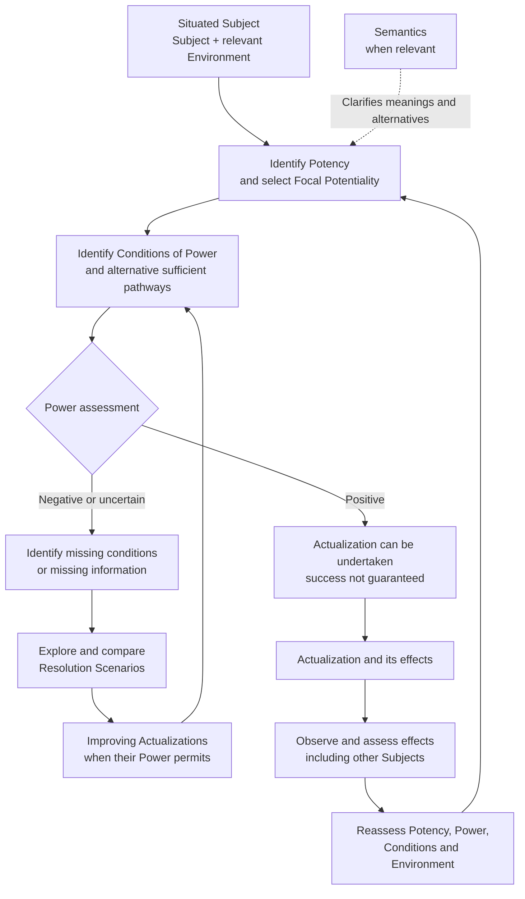

# Trialectic Method

**The Trialectic Method** is an interdisciplinary, contextual, systemic, and recursive framework for analyzing the Potentialities of a **Situated Subject**, the conditions under which they can be actualized, and the effects of their Actualization. It examines individuals, groups, technical objects, and systems through the relevant perspectives of **Subject**, **Environment**, and **Semantics**. These perspectives are neither equally weighted nor assumed to be universal causes.

The Method is an **analytical framework, not a universal ontology**. Its current reference is **alpha 0.3**, a work in progress that has **not been scientifically validated**.

## How it works

**Potency** is the set of a Subject's Potentialities at a given time. A **Focal Potentiality** is selected for analysis. **Power** is positive when at least one sufficient set of conditions allows its Actualization to be **undertaken**; this does not guarantee success. When conditions are missing—or prospects of success could be improved—the Method can explore **Resolution Scenarios** involving Improving Actualizations. Observed effects feed into reassessment.

The diagram is a **simplified analytical workflow**, not a mandatory linear sequence. Scenarios may also be explored when Power is already positive, to improve the prospects of success. If attribution of a Potentiality is not established, its constitutive foundation must be examined rather than assuming it exists. Simulations and anticipated effects are not Actualizations.

## Current use

The Method is currently being **developed, formalized, and critically examined** through:
- Conceptual clarification and documentation of definitions, distinctions, and decisions.
- Construction of a reproducible analytical protocol, including criteria for attributing Potentialities and assessing Power.
- Exploration of Resolution Scenarios, recursive effects, semantic dependencies, and illustrative cases.
- Preparation of comparative and empirical tests to determine when the framework provides useful results.

These are **development and research activities**, not demonstrated practical effectiveness.

## Potential applications

Subject to further development and evaluation, the Method could support:
- **Individuals and social groups:** analysis of behavior, relationships, and conflicts.
- **Institutions and public policy:** examination of constraints, alternatives, and distributive consequences.
- **Organizations and technical systems:** analysis of dependencies, design choices, and effects on stakeholders.
- **Philosophy and semantics:** clarification of meanings, conceptual structures, and disagreements.
- **Artificial intelligence:** adaptive dialogue that identifies relevant Potentialities, conditions, uncertainties, and possible revisions.

These are **potential applications, not validated use cases**. Comparative value, reproducibility, and practical limits remain open research questions.

## Repository documents

- [Reference alpha 0.3](reference/trialectic-method-alpha-0.3.md) — current working reference; distinguishes **VALIDATED**, **FORMALIZATION**, and **OPEN** statements.
- [TODO](TODO.md) — 29 research and development tasks and their statuses.
- [Decision log](DECISIONS.md) — decisions and validation history.
- [Contribution guidelines](CONTRIBUTING.md) — validation and commit procedure.
- [French–English terminology](terminology/french-english-glossary.md) — approved core translations and additional working equivalents.

## Working conventions

- **Explicit approval:** no conceptual modification is integrated into the main reference without the author's explicit validation.
- **Language:** English is the reference-document language; discussion may take place in French or English.
- **Evidence:** conceptual approval is not scientific validation. Hypotheses, formalizations, and unresolved questions remain clearly distinguished.
- **Documentation workflow:** GitHub is the sole active repository for reference documents, decisions, tasks, and version history. Dropbox and Dropbox Paper are no longer used.
