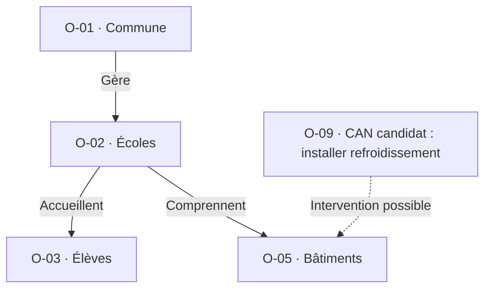
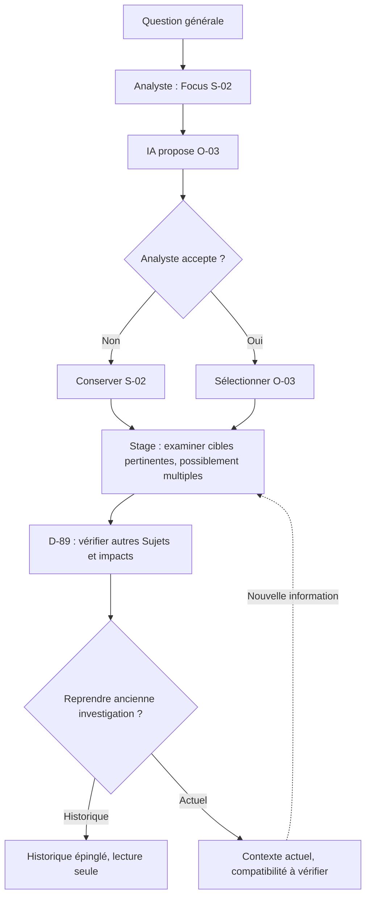

# trIA-dev — Analyst-controlled navigation Focus: three edge-case pilots

**Date:** November 17, 2026  
**Status:** **EXPLORATORY / WORKING**, not validated as a normative Method rule, production interface specification, independent test or empirical study.  
**Branch:** `dev`  
**Existing grounds:** D-17, D-58–D-60, D-85, D-88, D-89 and the D-90 interactive graph/presentation (do not infer automatic conversation synchronization).  
**Related tasks:** T-03, T-04, T-20, T-21, T-24, T-27, T-30.  
**Follow-on:** [Stage target vs navigation Focus](tria-dev-focus-vs-stage-2026-11-17.md).  
**Context:** fictional six-school overheating problem; O-01 commune main Subject, O-03 pupils secondary Subject, S-02 active cooling Scenario, S-04 combined Scenario.

## 1. Question

Does treating Focus as a **temporary, optional Analyst navigation selection**, conceptually separate from a Stage's examination targets and from PowerEvaluation.Focus, handle:

1. Multiple relevant targets and parallel analysts/branches?
2. AI suggestions without silently replacing an Analyst's explicit choice?
3. Resuming an earlier Focus with historical or current definitions/assessments?

**User preference, not final author validation:** Focus is tentatively preferred in the **Analyst steering / navigation layer**, not the Method's mandatory analytical core. Tests should try to falsify the separation rather than present it as already normatively settled.

## 2. Working distinctions

- **Candidate target**: existing Object or Scenario that can be suggested for investigation; proposing it makes no claim about its truth or appropriateness.
- **Selected navigation Focus**: an optional pointer used to express a given Analyst's local attention in a given analysis/branch; it does not itself alter Object Definitions or Power evaluations.
- **Stage examination targets**: an explicitly meaningful set of references determined by the operation, which can include several Objects/Scenarios even if one local navigation Focus is active.
- **AI suggestion**: recommendation, not Analyst acceptance or navigation selection.
- **Historical revisit**: read/pin an earlier context/version; not restoration of the world or a new Actualization.
- **Current revisit**: retain stable target identity while rechecking Definition version, Scenario/time, evidence, assumptions and PowerEvaluation reuse compatibility before any new evaluation.
- **D-89 safeguard**: local selected attention cannot exclude affected Subjects and important effects from the overall inquiry.

These are provisional distinctions for this pilot; no new `Focus` domain Object or mandatory `Stage.targets` schema is adopted.

## 3. Pilot A — Several relevant targets simultaneously

**Case:** Analyst A has S-02 selected, with O-03 also relevant; a Stage compares S-02's possible effects on O-03.

**Mock state:**
- Candidate targets: `[S-02, O-03]`.
- One active explicit selection: `S-02` (as a provisional interface choice, not a universal limit).
- Stage `compare_effects` has targets `[S-02, O-03]`.
- Navigation itself revises zero evaluations.

**Counterexample:** A system which replaces the Stage's targets with only the currently selected Focus would omit O-03, contrary to the actual analytic operation and potentially D-89.

**Additional isolation exercise:** Analyst B independently selects S-04 for the same case, while Analyst A continues to have O-03 in a different local navigation state; Analyst A also selects S-02 in a separate Scenario branch. This demonstrates that **namespace by analyst and branch** is a possible design strategy, not that concurrency, authorization, sessions or merges have been implemented.

## 4. Pilot B — AI proposes, Analyst chooses

Initial selection: S-02.

1. AI proposes O-03; proposal remains pending; S-02 is still selected.
2. Analyst rejects O-03; pending item becomes rejected, S-02 remains selected.
3. AI proposes O-03 again; Analyst **explicitly accepts**; O-03 becomes selected.

**Test distinction:** `ai_suggestion` and `manual_selection` are separately recorded hypothetical event classes. Neither an AI-generated proposal nor ordinary AI attention movement is automatically an Analyst decision.

**Open:** explicit delegated authority for automatic switching, limits on repetitive suggestions, proposal provenance and confirmation UX.

## 5. Pilot C — Resume a historical Focus

Scenario S-02 has a hypothetical historic Definition `v1`; `v2` is a **simulated later version**, not an actual update to the user's six-school case or GitHub Objects.

- **Historical resume:** select S-02 with `v1` pinned, display earlier evaluations read-only, do not reinterpret them as current.
- **Current resume:** select stable S-02 target with `v2`, require context/Definition/evidence/Scenario/time compatibility checks before reusing a previous Power evaluation. A mismatch may demand new assessment or an explicit indeterminate status.
- Neither operation performs an Actualization, rewrites history, changes `PowerEvaluation.Focus` contract or silently revises existing assessments.

**Failure avoided:** treating a stable ID as proof that a prior Power conclusion still holds after context changes.

## 6. Synthetic structural assertions

A deterministic, ephemeral JavaScript mock verified **14/14 authored invariants**:

1. Two candidate targets may coexist.
2. A single explicit selection can coexist with multiple candidates.
3. A Stage can expressly target multiple entities.
4. Navigation produces zero evaluation revisions.
5. An AI suggestion does not override Analyst selection.
6. Rejecting a suggestion preserves selection.
7. Accepting one changes selection by explicit Analyst action.
8. Analyst states are isolated in the mock.
9. Scenario branch states are isolated in the mock.
10. Historical revisit retains pinned `v1` and read-only presentation.
11. Current revisit uses `v2` but flags assessment compatibility for review.
12. Resume causes no Actualization.
13. Suggested vs selected action provenance are distinguishable.
14. Global D-89 scope remains applicable outside selected S-02.

**Non-evidence:** Passing self-authored invariants in a toy JS state machine is not a test of the repository's actual application, UI events, real concurrency, durable persistence, PowerEvaluation schema conformance or scientific value. Candidate object types, ownership keys and focus cardinality are exploratory. No performance or usability benefit is measured.

## 7. Separate Mermaid views

### Conceptual Objects/relationships (fictional; no navigation nodes)

Solid edges: case premises. Dashed edge: hypothesis, not an established CAN attribution, efficacy or Actualization.

### Method process/navigation (proposed)

Stages and assessments are not inferred solely from navigation selection. No fixed phase ordering is imposed by the diagram.

## 8. Findings and recommended next step

**Working architecture:** maintain explicit Stage operation and relevant examination targets in the analytical core. Treat Analyst-selected Focus as **optional navigation-layer state**; permit proposed targets and navigation history, and preserve assessment-revision semantics independently. Do not conflate AI proposal with Analyst acceptance or historical revisit with current-state recomputation.

**Next discriminating tests:**
- Independent analyst usability comparison of named Focus vs simple UI selection, with preregistered criteria and costs.
- Multiple simultaneously *active* selections: decide whether this is conceptually useful or simply Stage multi-target/context.
- Concurrent session edits, stale object references, conflict resolution and authorization under a real implementation.
- AI delegated selection with bounded authority and explicit revocation.
- Automatic graph synchronization only if supported and actually tested.

**Status:** The tests reinforce the provisional **steering-layer preference**, but do not validate Focus as a necessary standalone conceptual primitive, an auto-navigation feature or new persistent schema. D-17 and PowerEvaluation.Focus remain unchanged.
