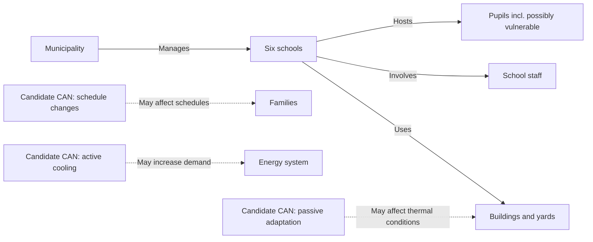
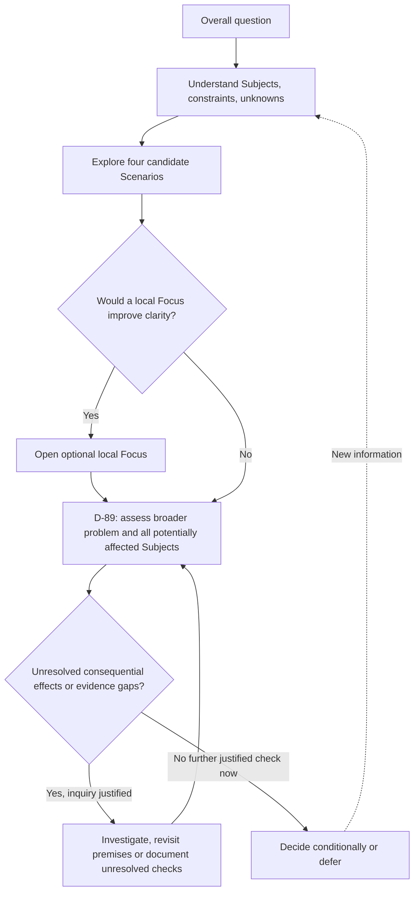

# trIA-dev — Three-mode Focus comparison (synthetic protocol pilot)

**Date:** November 17, 2026  
**Status:** **EXPLORATORY, NOT VALIDATED**. Same-model authored qualitative walkthrough; no blinded or independent assessment, measured human time, formal software test or new conceptual decision.  
**Scope:** D-17 (existing Focus definition), D-85 (three phases), D-88 (two Mermaid views), D-89 (relevance relative to Focus, global problem and affected Subjects), T-03/T-04/T-15/T-21/T-27/T-30.  
**Relation to previous pilot:** [D-89 two-mode pilot](tria-dev-relevance-focus-pilot-2026-11-17.md).

## 1. Predeclared comparison design

Three **methodological** configurations, holding information and D-89's global relevance safeguard constant:

- **A — No separate Focus:** use an overall question, Subject/Environment and Understand–Explore–Decide phases. An ordinary local question may be articulated in prose but no distinct `Focus` concept or forced label is introduced.
- **B — Optional Focus:** use the same overall method and introduce an explicitly named local Focus **only if an inquiry benefits from a bounded subquestion**; retain the global safeguard when switching attention.
- **C — Mandatory Focus at each local Stage:** require a named current Focus for every Stage/operation, changing it when necessary. Do not force unsupported NEED/CAN identities. The mandatory label is a **working comparison rule**, not a validated feature or an alteration of existing PowerEvaluation schemas.

**Do not equate:** D-85's analytical concern, D-17's methodological `Focus`, and the typed `PowerEvaluation.Focus` (NEED/CAN/Scenario) have different scopes.

**Comparison rubrics, fixed before walkthroughs:** coverage of (1) affected pupils and possible heat vulnerability, (2) families/schedule, (3) staff/working conditions, (4) energy/operating costs of active cooling, (5) unequal exposure and prioritization, (6) two-year budget and continuity of schooling, (7) absence of reliable building-level measurements; ability to trace subquestions; unjustified assertions; explicit stopping/reopening reasons; cognitive/documentation overhead. All facts in the input are **declared fictional assumptions**; discovered mechanisms are hypotheses, not empirical truths. No invented percentage or ordinal "quality" score.

## 2. Frozen fictional input

A commune manages six schools; two experience recurring hot-weather disruptions. The commune has **€800,000 available over two years**, and schools should stay operational during any work. Potential families' scheduling constraints and teachers' working conditions matter. Passive shading, targeted active cooling and scheduling changes are conceivable actions, but building-level measurements, installation quotes and technical feasibility are **unavailable**. One of the two particularly affected schools serves some pupils who may be more vulnerable to heat; their risk and what accommodations are required have **not been assessed**. The commune wants equity and to avoid excessive future energy use. No action has occurred.

**Overall question:** “How should the commune reduce heat-related disruption while protecting affected people, fairness and public resources?”  
**Focal Subject:** commune; schools, pupils, staff, families, energy system and potential contractors are Environment or possible Secondary Subjects depending on the investigation.  
**Three phases:** Understand → Explore → Decide or qualified deferral; recursion allowed.

The case intentionally contains information that an overly budget-centered local focus might hide; that information is equally visible to all three conditions.

## 3. Matched walkthroughs

### A — No separate Focus

**Understand:** Start with the overall question and map municipality, six schools, pupils (including possibly vulnerable pupils), staff, families, school buildings, financing and energy. Distinguish declared facts from uncertainties. “Heat” may concern temperature, wellbeing or disrupted teaching; “equity” is not necessarily an equal monetary allocation.

**Explore:** Compare (S1) passive changes, (S2) active cooling, (S3) organizational measures and (S4) adaptive combination. Directly test all seven rubric considerations. Flag family impacts of timetable changes, energy impacts of cooling, disparities between schools, and unresolved high-consequence vulnerability. NEED/CAN identification and attribution remain hypotheses if not justified; Power is indeterminate absent sufficient technical/budget conditions.

**Decide:** Choose, at most, conditional targeted diagnosis, participation and assessment; do not authorize an uncosted program. Explicitly leave final works and safety guarantees unresolved.

**Possible advantage:** economy of terms and flexible view of the whole. **Possible weakness:** individual subquestions and later returns are recorded only in phase narrative or headings, making local traceability less standardized.

### B — Optional Focus

**Understand:** Same full Subject/Environment inventory and uncertainties as A; no additional Focus label needed while framing the problem.

**Explore:** When comparing S1–S4, open a named local **Focus F-B1: “budget feasibility of the options.”** Track missing quotes, timing and operational cost. Before limiting the analysis, explicitly apply **D-89 global safeguard** to pupils/vulnerability, equity, families, staff, energy and overall purpose. The safeguard reveals that cost is only one decision dimension. When separately examining possible effects of timetable changes, optional **Focus F-B2: “S3 impacts on families and staff”** clarifies the local inquiry without redefining the Subject.

**Decide:** Reintegrate full criteria; provisional data-gathering decision. Neither local Focus settles whether the overall Scenario is acceptable.

**Possible advantage:** selected subquestions are explicitly identified and reopenable while keeping the overall question visible. **Possible weakness:** users may treat the selected Focus as the only relevant criterion if D-89 is not actively applied.

### C — Mandatory Focus

**Understand:** Record **Focus F-C1: municipality as situated Subject**, then **F-C2: disruption in the two overheated schools**, then **F-C3: uncertainty of pupil heat vulnerability** to cover the same inventory. No unvalidated NEED classification is imposed solely to populate the Focus.

**Explore:** Explicit named Focus transitions are required for **F-C4: passive adaptation option**, **F-C5: active cooling option**, **F-C6: scheduling option**, **F-C7: combination option**. Each requires its own D-89 global check: pupil vulnerability, equity, staff, families, energy, budget, continuity and missing measurements are retained. Relevant candidate CANs and Conditions can be examined, but identities, attribution and efficacy remain unverified.

**Decide:** **F-C8: conditions required for a decision on a pilot/diagnosis**. Report the same conditional decision as A and B. An unscoped action cannot be inferred from the number of Focus transitions.

**Possible advantage:** explicit operation-by-operation attention trace. **Possible weakness:** many transitions and duplicated global checks, potentially creating administrative overhead and artificial segmenting of related questions. If a mandatory Focus is restricted exclusively to NEED/CAN/Scenario, some legitimate comprehension operations do **not** naturally fit that scheme, exposing a conceptual mismatch rather than justifying fabricated NEED/CAN Objects.

## 4. Comparison — analytical observations only

| Predetermined criterion | A: none | B: optional | C: compulsory |
| --- | --- | --- | --- |
| Pupils, vulnerability, families, staff, energy, fairness, budget, missing data | All seven considerations explicitly addressed | All seven addressed with global check | All seven addressed with repeated global checks |
| Independent empirical claims justified | None | None | None |
| Local subquestion trace | Prose and phase headings; no dedicated term | Explicit for the two selected local questions | Explicit for every Stage (eight synthetic labels) |
| Measured time/cognitive effort | **Not measured**; potentially low overhead | **Not measured**; selective overhead | **Not measured**; greatest labeling burden in this written example |
| Risk of narrowing | Initial question may narrow | Local label may anchor without D-89 | Artificial segmentation and repeated anchoring |
| Stop/reopen | Scope, unresolved vulnerabilities and checks described | Same plus Focus switches | Same plus frequent Focus transitions |
| Real-world effectiveness | **Untested** | **Untested** | **Untested** |

**Count clarification:** 0 / 2 / 8 Focus labels above are **features of these authored walkthroughs**, not measured operational efficiency or independent trial results. The configurations are deliberately constructed to test conceptual behavior, not to rank the Method from numerical performance.

**Interpretation:** D-89's **global problem/affected-Subjects relevance check** is the key safeguard common to the three conditions; it is not proof of full coverage. Optional Focus seems plausible as a **local attention/traceability label**. Making it mandatory appears more burdensome in this case and could force unwarranted Object classification if narrowly typed. This does **not** demonstrate that Focus is conceptually redundant, nor authorize changing its validated D-17 definition or the PowerEvaluation.Focus field.

## 5. D-88 Mermaid graphs

### Conceptual graph (same factual/hypothetical case for all three)

*Solid = declared fictional relationship. Dotted = conditional hypothesis, not verified causal proof or CAN attribution.*

### Methodological graph (configuration B, optional Focus)

*This is a proposed attention/iteration depiction, not a newly validated stopping algorithm.*

## 6. Open issues and proposed follow-up

1. **Incremental usefulness:** Before deciding whether Focus should be a permanent distinct concept, compare with well-written ordinary subquestion headings. The value of naming local attention does not automatically require a new domain Object or method component.
2. **Different layers:** Clarify relation between analytical concern/question, the Stage's attentional Focus, and `PowerEvaluation.Focus` as a technical typed identifier. The latter has a validated *local data-contract role* regardless of the global methodological experiment.
3. **Relevance safeguard cost:** D-89 requires checking affected Subjects across Focus changes; establish proportionality, audit reasons and stopping conditions, without arbitrary scoring.
4. **Independent test:** Freeze a small case corpus, predefine expected critical omissions and evaluation criteria, allocate condition A/B/C to independent analysts (ideally blinded to hypotheses), track recall of relevant Subjects, unsupported assertions, time, number and quality of revisions and user understanding. Include simple low-stakes cases and adversarial serious-omission cases; report inconclusive or adverse results.
5. **Author decision requested later, not presumed now:** Keep Focus, narrow it to an optional local procedural label, distinguish it from analytical question, or drop the separate Method-level term while retaining the `PowerEvaluation.Focus` technical discriminator. **No choice is validated by this pilot.**

**Conclusion:** This exercise supports **testing optional Focus first**, but only as a design hypothesis. D-89 remains the sole new validated relevance principle; the four provisional investigation actions and stopping threshold remain OPEN.
