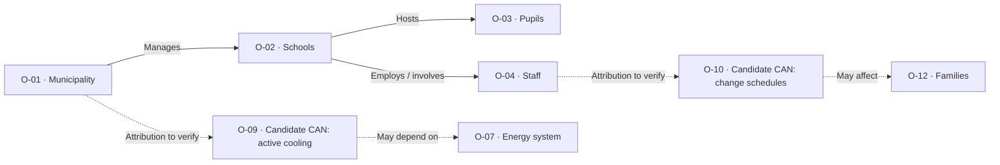
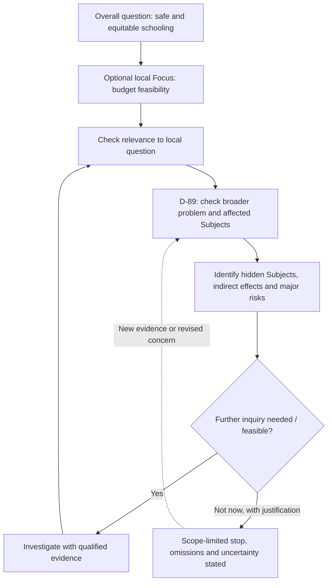

# trIA-dev exploratory pilot — analytical relevance, stopping and Focus usefulness

**Date:** 2026-11-17  
**Branch:** `dev`  
**Status:** **EXPLORATORY WORKING EXERCISE — NOT a validated protocol, independent study, empirical test or new decision**  
**Decisions:** D-02, D-07, D-17, D-83–D-89  
**Tasks:** T-03, T-04, T-15, T-21, T-24, T-27, T-30

## 1. Question and boundary

**Author-validated D-89 principle:** assess relevance **both to the current Focus, if present, and to the overall problem, objectives and other potentially affected Subjects**. A narrow Focus cannot silently exclude important indirect consequences or overlooked Subjects. The added value of the *separate conceptual notion of Focus* remains **OPEN**. This experiment does not amend the validated focus-specific `PowerEvaluation.Focus` transport contract.

**Questions for the pilot:** (i) Can an analyst avoid consequential omissions without limitless contextual expansion? (ii) Does explicitly naming a Focus offer measurable value over working from the analytical question and the three D-85 phases alone? (iii) Can a relevance/stopping protocol be followed without pretending to have evidence not supplied by a case?

**Limit:** All three cases are **synthetic**. The same assistant authors both compared walkthroughs, so they are *not blind, independent, controlled or empirical comparisons*. Apparent benefits below are only **plausible observations**, not evidence of superiority.

## 2. Working protocol — proposed only

1. Record the **problem/question, main Subject, known or hypothetical affected Subjects, scope and evidence status**.
2. In condition **F**, state an explicit local **Focus**; in condition **N**, do not name a separate Focus and use the question/phase to orient the analysis. **Both conditions** retain D-89's global problem/affected-Subjects safeguard and equal initial information; the experiment is not "careful" vs "careless" analysis.
3. For each candidate Object, relation or effect, check **possible impact on the current inquiry (and on Focus if used), overall problem, affected Subjects, uncertainty, severity of omissions, and available verification effort**.
4. Provisional investigation actions (NOT validated): **investigate**, **monitor**, **suspend with reasons**, or **exclude within stated scope with reasons**. Preserve missing information and uncertainty; inclusion does not establish truth/attribution/causality.
5. After one scoped pass, record **newly included Subjects/relations, missed or unresolved questions, additional analytical effort, stopping or reopening reasons**. Keep any action/decision separate from an observed Actualization.
6. Stop a pass when enough has been learned **for the declared scope** or when additional checks are unavailable/disproportionate; explicitly record unexamined potentially consequential links and do not turn "not checked" into "not present." For high-stakes consequences, examine feasible discriminating checks or document the unresolved risk.

**The proposed criteria, four actions and stop wording are neither D-89 author-validated rules nor JSON schema.** This pilot records whether they appear usable before asking the author to decide.

## 3. Three synthetic trials

### P1 — Simple: reading with a broken desk lamp

**Same data for both conditions:** Person wants to read a paper book tonight; desk lamp will not turn on; a working charged flashlight is available.

- **F:** Explicit local Focus "restore desk-lamp lighting." The Focus supports a specific repair inquiry, but the D-89 global problem check ("read tonight") reveals the flashlight as a candidate alternative; no proof of its lighting adequacy. Without the broader check, the Focus could bias the analysis toward unnecessary repairs.
- **N:** No separately named Focus; inquiry framed as "how to read tonight." The flashlight becomes an immediate alternative, with a check for sufficient illumination. More economical for this simple case.
- **Provisional finding:** For a small problem, explicit Focus may **add overhead** and risk premature narrowing. It can still help if troubleshooting the lamp is the actual analytical purpose. This is a contrast of problem formulation and attention, not proof that Focus is dispensable.

### P2 — Multi-Subject: six schools exposed to high heat

**Same fictional data for both conditions:** Six schools, two suffering from heat, limited municipal budget, contested equity, teachers and pupils affected; alternatives include passive shading, active cooling and schedule changes.

- **F:** Explicit Focus "budget feasibility of building adaptations." The local inquiry supports financial/technical comparison. D-89's global problem check identifies **families potentially affected by changed schedules**, students potentially exposed to continuing heat and energy impacts of active cooling. These were outside the narrow budget Focus.
- **N:** Problem-oriented inquiry ("preserve safe and equitable school activities") identifies families and energy use directly when alternatives are considered. However, the analyst must still deliberately track which cost/technical question is being examined to avoid diffuse analysis.
- **Provisional finding:** Explicit Focus can clarify a **local question within a large analysis** and provide a reason for returning to a prior stage. Yet it must not become an exclusion filter. Both variants can find secondary Subjects when D-89 is applied.

### P3 — Serious omission: constrained emergency water supply

**Same synthetic data:** A local authority must allocate scarce essential water; the initial inventory emphasizes housing. A care facility's essential water demand may have been omitted; its amount and risks have not been verified. No real-world emergency decision or quantity is being asserted.

- **F:** Explicit Focus "cover residential water demand." The global Subjects/risk check identifies the care facility as an **unverified but potentially high-consequence** omission. Decision may require urgent verification, alternative provision, or qualified suspension of a final allocation.
- **N:** Problem-oriented inquiry "meet critical water needs without severe omissions" also highlights the care facility. The absence of a named Focus does not automatically improve detection; deliberate consideration of hidden Subjects remains necessary.
- **Provisional finding:** The global safeguard is more important than the label Focus. A merely low estimated likelihood or unverified NEED is not sufficient reason to hide potentially severe risks, but this does not establish the facility's actual needs or any quantitative probabilities.

## 4. Comparison matrix (qualitative observations, not independent measurements)

| Criterion | F — explicit local Focus with D-89 safeguard | N — no separately named Focus, same safeguard |
| --- | --- | --- |
| Trace a local subquestion | Easy to label and revisit | Possible via the analytical question or phase |
| Detect hidden affected Subjects | Requires the **global check** despite Focus | Requires the **same global check** |
| Avoid anchoring on a narrow interpretation | Vulnerable without explicit rechecking | Also vulnerable to its initial problem formulation |
| Simple-case cognitive overhead | Potentially higher | Potentially lower |
| Complex-case task organization | Potential benefit | May need an equivalent name for the local question |
| Epistemic or causal validation | Neither condition establishes it | Neither condition establishes it |

**Key outcome:** These walkthroughs do **not demonstrate that a distinct Focus concept is necessary**. They do show a plausible use for **tracking a local inquiry** within a multi-stage analysis. Whether that should remain an independent domain concept, a flexible metadata field, an ordinary question label, or only a scoped `PowerEvaluation.Focus` must be tested, not assumed.

## 5. Dual Mermaid views — trial P2

The following diagrams illustrate D-88; they do not represent causally proven links.

### Conceptual Object graph

*Solid edges are declared fictional case relationships. Dotted edges are hypothetical or unverified; none proves NEED/CAN attribution or causality.*

### Methodological process graph

*This diagram is a working attention/selection loop, not a new normative set of stages or a guaranteed automatic stopping rule.*

## 6. Failures, caveats and next tests

1. **Circularity risk:** If "relevant" means merely "what matters," an analyst may be unable to apply the criteria consistently. Require an explicit anticipated change to a question, assessment, affected Subject or evidence gap, without assuming that anticipated change is true.
2. **Hidden-Subject paradox:** A safeguard cannot guarantee discovery of Subjects that have not even been imagined. Compare against independently designed adversarial cases and allow explicit incomplete coverage.
3. **Stopping risk:** "Enough understanding" is relative to aims, stakes and evidence; a reasoned stop can coexist with unresolved high-stakes risks but should **not** be represented as full resolution or an unqualified decision.
4. **Focus duplication:** D-85 already has an analytical concern; D-17 has Focus; `PowerEvaluation.Focus` also selects NEED/CAN/Scenario. The three uses must not be silently equated. Evaluate whether separate global and local concepts are actually needed.
5. **Measurement plan:** Assign independent analysts the same frozen cases, vary the presence of a Focus label while holding prompts, data, time and evaluation criteria as constant as practical. Record omissions, critical hidden Subjects, alternative diversity, unsupported claims, traceability and analyst time. Include no-gain/harm cases. Define the rubric before evaluation, then consider author validation of any revised operational protocol.

**Result status:** A **manual conceptual exercise** completed and documented, with a testable hypothesis: Focus may help with local attention and traceability but is not an acceptable exclusive relevance criterion, and its necessity as a separate concept remains open. No software test suite, external review or real-world comparison was performed.
