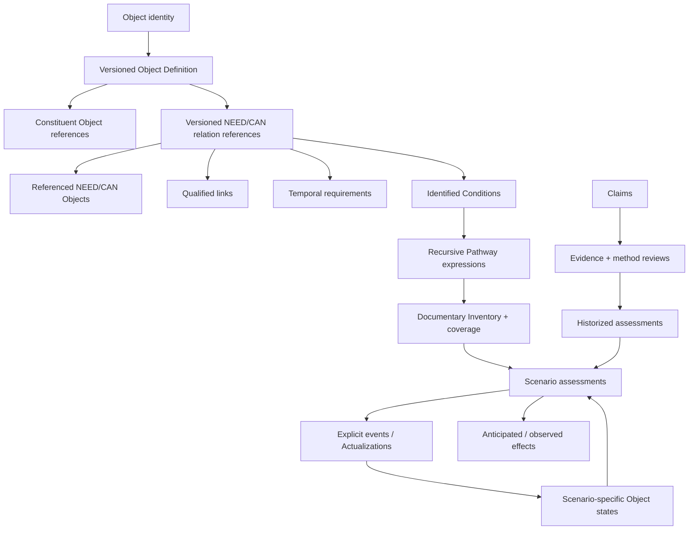

# Trialectic normalized data model — proposal v0.1

**Status: HISTORICAL TECHNICAL PROPOSAL; SELECTED CHOICES VALIDATED BY D-75, NOT A COMPLETE APPROVED SCHEMA.**

**Current approval:** V-01–V-06 are approved within the precise boundaries in the [reconciliation register](RECONCILIATION.md). C-01–C-10 list conflicts with approved contracts and proposed, unapproved resolutions. The JSON/example remain unchanged; the older OPEN labels below describe their original status and are superseded only for those selected choices. This directory is a candidate exchange/storage format for the **`dev`** branch. It does **not** change `reference/trialectic-method.md`, `DECISIONS.md`, or close any TODO. The canonical Method remains the working reference. This proposal incorporates developments through November 16, 2026, particularly the revised Focus-centered operation of Power.

## Files

- [`trialectic.schema.json`](trialectic.schema.json) — one JSON Schema Draft 2020-12 root schema; common reusable `$defs` for all record families.
- [`example.json`](example.json) — synthetic, intentionally hypothetical CAN/NEED case, not empirical evidence.
- [`OPEN.md`](OPEN.md) — unresolved conceptual and engineering choices, with suggested validation order.

## Structural map



This map is **not** a causal graph, nor proof that a stored link is sufficient.

## Normalization boundaries

| Canonical entity | Identity | Versioned? | Data and role |
| --- | --- | --- | --- |
| Object | `object.id` | Definition versions | Permanent identity, category and Parent/Children lineage |
| Object Definition | `(object_id, version)` | yes | Constituents, property descriptions, related NEED/CAN record references |
| NEED/CAN relation | `(relation.id, version)` | yes | Origin Object, represented NEED/CAN Object, participant Object references, nature, links and optional temporal requirements |
| Link | `(relation.id, version, link.id)` | through owner | Role, conditional mechanism, affected local links, contextual weight |
| Condition | `(owner_relation.id, owner_relation.version, condition.id)` | through owner | Predicate and target; **not** an Object by default |
| Pathway | `(owner_relation.id, pathway.id, pathway.version)` | yes | Expression, scoped completeness |
| Inventory | `(owner_relation.id, inventory.id, inventory.version)` | yes | Search status, completeness, optional evaluable expression |
| Scenario | `scenario.id` | isolated historical states | Parent scenario, snapshots, events, Definition heads |
| Event | `event.id` within scenario | historicized | Simulated vs effective Actualization and distinct knowledge/Definition events |
| Assessment | `assessment.id` | append-only histories intended | Condition / NEED / Focus-centered Power / claim evaluations |
| Evidence | `evidence.id` | recorded with provenance | Source method, root origin and distinct review |
| Effect | `effect.id` | scenario-bound | Anticipated vs observed vs causally attributed, independently from physical transitions |

**Canonical proposal choice A (OPEN):** A relational record has a separate `represented_object` referencing the NEED/CAN as an Object; `origin_object` is the Object to which it is attributed. This is one way to reconcile the D-36 relation and November 16 Object-identity rule; the identity mapping is **not yet approved**.

**Canonical proposal choice B (OPEN):** D-36's author-approved keys `ID`, `Type`, `OriginObject`, `NEEDs`, `CANs` are transported as `id`, `type`, `origin_object`, `NEEDs`, `CANs` and a new `version`, with `NEEDs` / `CANs` holding `{id,version}` rather than bare IDs. This is a **lossless mapping only if each historical referenced Object version is known**; it is a proposed transport format, **not a replacement of the validated D-36 example without approval**. `null` remains distinct from `[]`, but their complete semantics are OPEN.

**Canonical proposal choice C (OPEN):** all nested Boolean grouping uses one `logic` grammar: `{"op":"all"|"any","items":[...]}` or a typed, versioned `{"ref":{...}}`. The grammar is shared; **meanings are not merged**. Object-link composition, Conditions, Pathways and time requirements require distinct semantic interpretation. A documentarily empty Inventory uses `expression:null`, **never an empty Boolean group**.

**Canonical proposal choice D (OPEN):** timestamps use RFC3339/ISO8601 offsets; temporal requirements remain tied to Definitions; current/historic states and all evaluations live only in Scenario-specific records. `kind:"knowledge_revision"` and `kind:"observation"` events cannot contain physical `state_changes`. Scenarios' `mode` does not by itself prove real-world Actualization.

**Canonical proposal choice E (OPEN):** `power_assessments` center on one explicit NEED, CAN or Scenario Focus. They record compared NEED assessments and candidate CANs and an optional/contextual actualizability result; **they do not define Power as just a binary field**. Partial actualizability degree may be recorded with explicit units and a defensible measurement method; never compute arbitrary confidence from a weight.

## Technical versus analytical verification

A passing JSON Schema check validates **shape, required keys and enum domains only**. It does not validate: cross-document references and IDs; relation-link membership; expected owner/version of typed references; hidden missing conditions or pathways; causal sufficiency; branch promotion or shared-Object propagation; legitimate authorized temporal exceptions; evidence independence; or real-world effectiveness.

A future *semantic validator* must at least assert:

1. Every Object, Relation, represented NEED/CAN Object, Definition version and typed reference resolves uniquely.
2. Every Link's `object_id` is listed in its owner's specified `source_list`; link IDs are unique within that Relation/version and `affects` targets resolve within agreed scope.
3. Conditions are scoped to the owning Relation/version; expression refs have a valid `kind`, owner and version. Empty `all`/`any` and unguarded recursive expansion are forbidden.
4. Scenario parent and Object lineage are consistent and acyclic where required; shared Object snapshots remain isolated by Scenario, and effective promotion never changes a temporary child's permanent ID.
5. A state change is documented as an explicit Actualization; an epistemic correction cannot change physical state by fiat.
6. A complete pathway, complete inventory and complete Power have **different** proof obligations. No identified pathway does not entail impossibility.
7. NEED effective satisfaction and temporal compliance are evaluated separately, including interval violations and explicitly authorized exceptions.
8. Claim status `established_in_model` does not imply empirical proof; reports sharing a root source are not counted as independent confirmations.

### Run structural schema validation

Install a third-party JSON Schema validator **outside existing project runtime dependencies**, for example:

```bash
python -m pip install jsonschema
python -c "import json; from jsonschema import Draft202012Validator, FormatChecker; s=json.load(open('schemas/proposal-v0/trialectic.schema.json', encoding='utf-8')); x=json.load(open('schemas/proposal-v0/example.json', encoding='utf-8')); Draft202012Validator.check_schema(s); Draft202012Validator(s,format_checker=FormatChecker()).validate(x); print('Structural validation passed')"
```

No CI check or full semantic validation is claimed by this document. The example is a toy assertion set, not proof of generator safety or an empirical result.

## Decision governance

- Apply D-75 V-01–V-06 only within their documented scope. Other fields and conflict resolutions remain **PROPOSED**; the full JSON schema is not approved.
- Before promoting a field into the canonical Method: document alternatives, reasons, interactions, tests, version migration and explicit author approval.
- Preserve historical source definitions and the distinction between conceptual decisions, formalized implementation, open research and empirical validation.
- Related work: T-30, T-01, T-02, T-03, T-05, T-15, T-16, T-18, T-21, T-24 and T-27.

